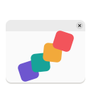
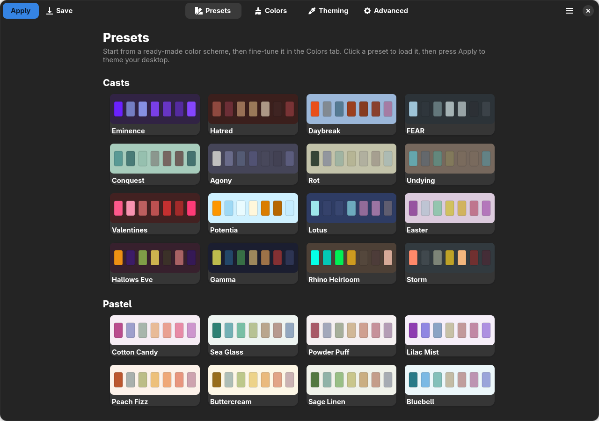
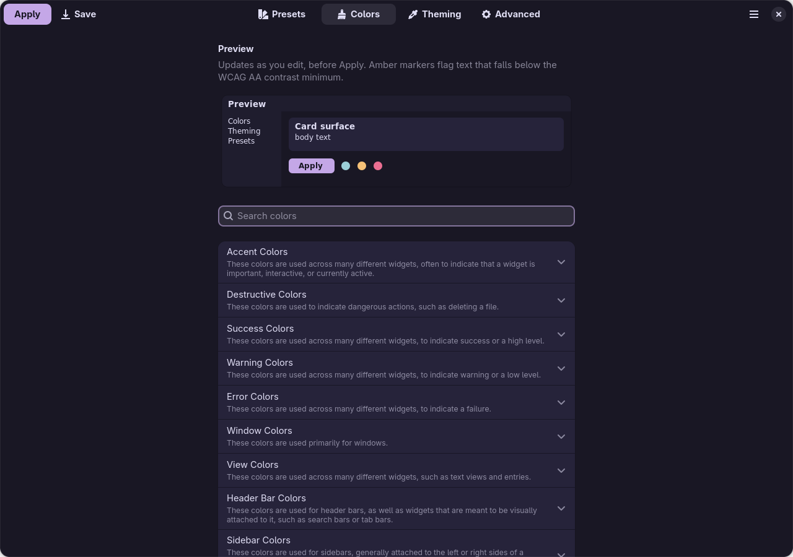
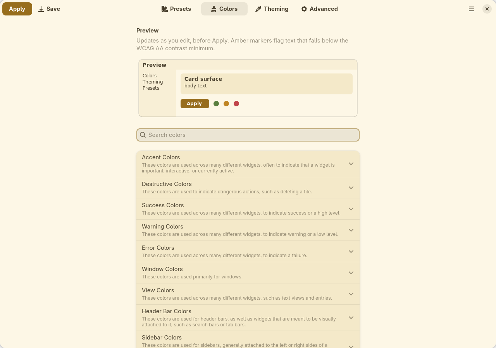
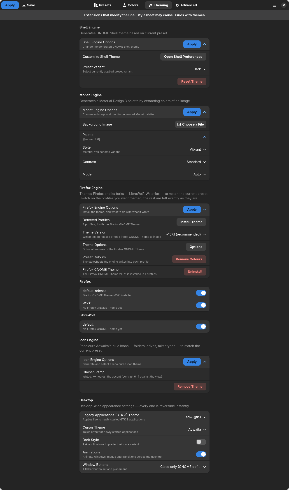

<p align="center">
  
</p>

<h1 align="center">Vivid Gradience</h1>

<p align="center"><strong>Recolor GNOME from one palette: Libadwaita and GTK apps, the Shell, Firefox and your icons.</strong></p>

Vivid Gradience is a GTK4 / libadwaita app for theming a GNOME desktop. Pick
one of **85 built-in color schemes** or build your own, and it writes that
palette to Libadwaita, GTK 4 and GTK 3 applications, GNOME Shell, Firefox and
a recolored icon theme. There are no config files to edit by hand, and
nothing it replaces is thrown away.

It is a maintained fork of [Gradience](https://github.com/GradienceTeam/Gradience),
which was archived in June 2024.

<p align="center">
  
</p>

**Current version: 0.7.1** · [What's new](CHANGELOG.md) ·
[Website](https://superuser-miguel.github.io/Vivid_Gradience) ·
[Get Set Up guide](https://superuser-miguel.github.io/Vivid_Gradience/setup.html)

## Install

### Recommended — signed repo, automatic updates

From the project's signed Flatpak repo. New releases arrive with
`flatpak update`:

```shell
flatpak install --user https://superuser-miguel.github.io/Vivid_Gradience-repo/VividGradience.flatpakref
flatpak run io.github.superuser_miguel.VividGradience
```

### Alternative — one-off bundle

Download `VividGradience.flatpak` from the
[latest release](https://github.com/superuser-miguel/Vivid_Gradience/releases/latest)
and run `flatpak install --user ./VividGradience.flatpak`. The single file has
no update path; you reinstall to move to a newer version.

Every release is signed with the project's GPG key. Vivid Gradience is not on
Flathub and is distributed independently.

## What it does

### Presets

- **85 color schemes built in**: Catppuccin, Gruvbox, Nord, Dracula, Rosé Pine,
  Everforest, Solarized, Tokyo Night and the full Arc and Matcha families,
  plus three original sets, **Pastel**, **Neon** and **Casts**.
- **A visual gallery.** Every scheme is a card in its own colors, grouped by
  family. Click one to load it, then press Apply.
- **Your own presets.** Save what you make, import a preset file, and manage
  them from the Preset Manager.

### Colors

<p align="center">
  
  &nbsp;
  
</p>

- **Every named Adwaita color**, in searchable, collapsible categories, by
  picker or hex value.
- **A live preview** at the top of the tab redraws as you edit, before
  anything is applied, and marks text that falls below WCAG AA contrast.
- **Colors that read.** Before a preset is written, red, green, amber and
  accent text is measured against the surfaces it sits on. Anything below
  4.5:1 keeps its hue and is made lighter or darker just enough to read.
  Colors that already pass are written exactly as the preset has them.
- **Pick from the preset itself.** Every color button opens the preset's own
  palette first, with the system dialog one click behind it.
- **A palette from your wallpaper.** The Monet engine turns an image into a
  Material You scheme, with nine style variants and a contrast level.
- **Custom CSS** for anything the named colors cannot express.

### Theme engines

<p align="center">
  
</p>

- **GNOME Shell, applied live.** The panel, overview, quick settings and
  notifications repaint on your running session, with no logout. It recolors
  the stylesheet your installed Shell already ships, so it follows whatever
  GNOME version you run. Needs the
  [User Themes](https://extensions.gnome.org/extension/19/user-themes/)
  extension, and the app tells you when that extension is missing, turned off
  or left out of date by a GNOME upgrade.
- **Firefox.** Toolbar, tabs, menus, Settings and the Library follow the
  preset, through
  [firefox-gnome-theme](https://github.com/rafaelmardojai/firefox-gnome-theme).
  The app installs a tested release of that theme for you and removes it as
  cleanly. Each profile has its own switch, and a profile you themed yourself
  is left alone. LibreWolf and Waterfox work too.
- **Icons.** Adwaita's blue folders, drives and file-type icons are recolored
  from the preset's palette. One click applies it, one removes it.
- **Desktop settings.** GTK 3 theme, cursor, dark style, animations and
  window buttons, with a warning when a chosen GTK 3 theme is one your Flatpak
  apps cannot find.

### Safe to try

- **Your existing theme is kept.** If Apply finds a stylesheet it did not
  write, it offers to move it into your theme library instead of overwriting
  it.
- **Every Apply is snapshotted**, so the previous state can be restored.
- **Firefox is undone exactly.** Switching a profile off removes what the app
  wrote and nothing else.

## Theming setup

Native Libadwaita apps need no setup. The
[Get Set Up guide](https://superuser-miguel.github.io/Vivid_Gradience/setup.html)
walks through everything from install to a fully themed desktop and back. The
short version:

- **Flatpak apps (GTK 4 / Libadwaita)**: grant access to the GTK 4 config with
  `sudo flatpak override --filesystem=xdg-config/gtk-4.0`, or the same entry
  in [Flatseal](https://github.com/tchx84/Flatseal).
- **GTK 3 apps**: install the
  [adw-gtk3](https://github.com/lassekongo83/adw-gtk3#readme) theme, grant
  `xdg-config/gtk-3.0` the same way, and install the Flatpak theme extension:

  ```shell
  flatpak install flathub org.gtk.Gtk3theme.adw-gtk3
  ```

  A Flatpak cannot see `/usr/share/themes`. Without the extension, host apps
  get adw-gtk3 and every Flatpak silently falls back to stock Adwaita. If some
  apps look right and others don't, this is usually why.
  [The measurements are here.](https://superuser-miguel.github.io/Vivid_Gradience/findings.html)
- **GNOME Shell**: install the
  [User Themes](https://extensions.gnome.org/extension/19/user-themes/)
  extension, then use the Shell engine in the Theming tab.

### What needs restarting

Not your session.

| Surface | To see a change |
| --- | --- |
| Panel, overview, app grid, <kbd>Super</kbd>+<kbd>Tab</kbd>, quick settings, notifications, lock screen | Nothing |
| A GTK or Libadwaita app | Reopen that app |
| Firefox | Restart Firefox |
| X11 titlebars on apps that draw no decorations | Restart `mutter-x11-frames` |

Named colors are read once, when an application starts.

## Reverting

Open **Preferences → Theming → Reset & Restore Presets** and reset GTK 3 or
Libadwaita.

<details>
<summary>Manual revert</summary>

```shell
rm -rf .config/gtk-4.0 .config/gtk-3.0
flatpak uninstall adw-gtk3
sudo flatpak override --reset
```

`flatpak override --reset` clears **all** Flatpak overrides system-wide.

</details>

## What's next

- **Blur my Shell detection**: say so when its popup blur is overriding the
  Shell theme's colors, with a one-click way to turn that off.
- **Theme installs from GitHub and `.zip`**, straight into the theme library.
- **A palette editor**: assign a preset's swatches to roles yourself, with
  contrast measured as you choose.
- **Later**: your own presets in the gallery, light/dark preset pairs, and a
  time-of-day cycle. The full list is in [ROADMAP.md](ROADMAP.md).

Past releases are in the [changelog](CHANGELOG.md).

## Build from source

Needs `flatpak-builder` and the GNOME 51 SDK and Platform runtime.

```shell
git clone https://github.com/superuser-miguel/Vivid_Gradience.git
cd Vivid_Gradience
flatpak-builder --user --install --force-clean builddir \
  build-aux/flatpak/io.github.superuser_miguel.VividGradience.json
```

For a host build (`meson >= 0.59.0`):

```shell
meson setup builddir --prefix=$HOME/.local
ninja -C builddir install
```

See [HACKING.md](HACKING.md) for details.

## A note on theming

Vivid Gradience is a tool for tinkerers and is **not intended for
distributions to ship by default**. A unified Adwaita look matters for app
developers; see [stopthemingmy.app](https://stopthemingmy.app) for the
reasoning.

## Acknowledgments

- [Artyom Fomin](https://github.com/ArtyIF) and
  [the Gradience Team](https://github.com/GradienceTeam), who made the
  original Gradience.
- [hydroxycarbamide](https://github.com/hydroxycarbamide/Gradience), whose
  Gradience fork this project is based on.
- [superuser-miguel](https://github.com/superuser-miguel), reviving and
  modernizing the fork.
- [firefox-gnome-theme](https://github.com/rafaelmardojai/firefox-gnome-theme)
  by Rafael Mardojai CM, which the Firefox engine builds on.
- [Weblate](https://weblate.org), the translation platform.

## License

Vivid Gradience is **GPL-3.0-or-later**.
